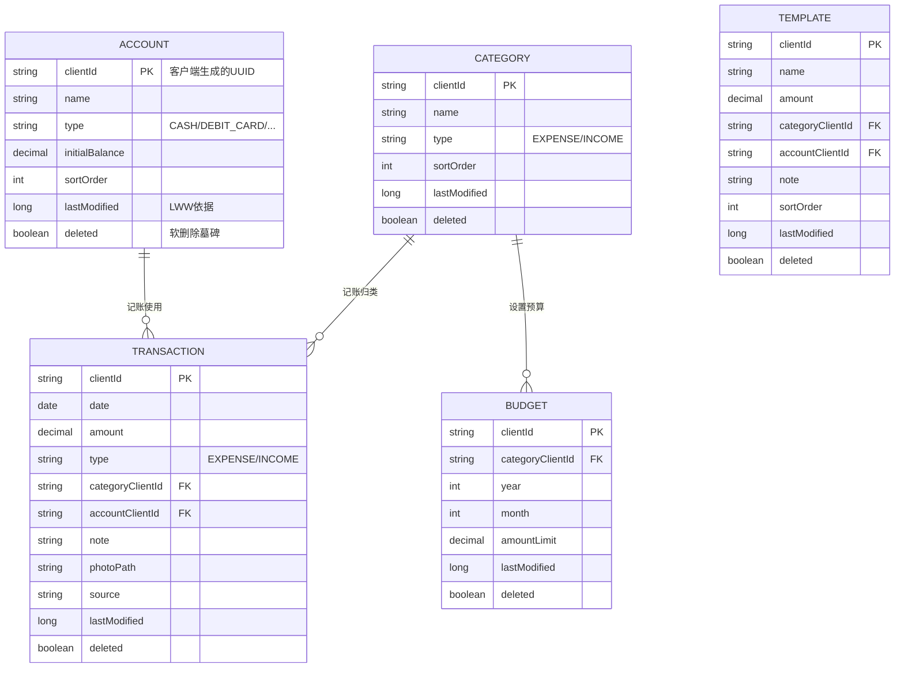

# 数据库 ER 图与云端/本地差异

## 实体关系概览

## 设计要点

- **跨设备引用用 `clientId`（UUID）而非自增主键**：一台设备新建的分类/账户可被另一台设备稳定关联，不因主键冲突而错乱。
- **`last_modified`（epoch 毫秒）** 是 LWW 的唯一依据；不做原子钟假设，客户端在本地写操作时打时间戳。
- **`deleted` 软删除墓碑**，保证删除操作能通过同步传播到其它端。
- **预算唯一键** 是 `(category_client_id, budget_year, budget_month)`，同一预算在两端重复创建时合并为一条。

## 云端(MySQL) vs 本地(SQLite / H2) 差异

| 项目 | 云端 MySQL | 本地 SQLite (Android) | 本地 H2 (Desktop) |
| --- | --- | --- | --- |
| 主键 | 自增 BIGINT + 唯一 `client_id` | `client_id` 为主键 | `client_id` 为主键 |
| 金额类型 | `DECIMAL(19,2)` | `REAL`(double) | `DECIMAL(19,2)` |
| 日期类型 | `DATE` | `TEXT`(ISO) | `DATE` |
| 布尔 | `TINYINT(1)` | `INTEGER(0/1)` | `INT(0/1)` |
| 索引 | 显式 `KEY idx_xxx` | 单表建 `CREATE INDEX` | `CREATE INDEX IF NOT EXISTS` |
| 额外表 | 无 | `sync_state` | `sync_state` |
| 额外字段 | 无 | 无 | 无 |
| 自动建表 | 依赖 `/sql/init.sql`（生产 `ddl-auto=none`） | 首次启动 `DatabaseHelper.onCreate` | 首次启动 `DataManager.initSchema` |

> 三端表结构语义一致（字段一一对应），仅存储类型不同，同步时通过 JSON 统一表示金额（数字）与日期（`yyyy-MM-dd`）。
